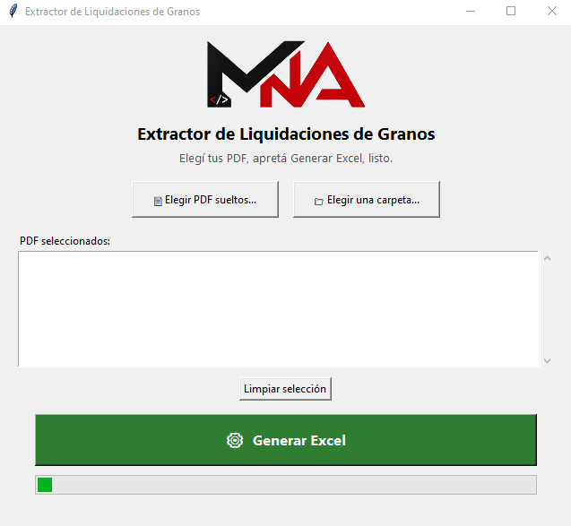

# Extractor de Liquidaciones de Granos (PDF → Excel)

Programa en Python que lee **liquidaciones primarias de granos de ARCA** en PDF y arma un Excel con los datos que importan, sin cargarlos a mano.

Incluye una **ventanita** (para usarlo sin saber programar) y una **versión por terminal**.

<p align="center">
  
</p>


## Qué extrae de cada PDF

| Columna | De dónde sale |
|---|---|
| FECHA | Fecha de emisión del comprobante (encabezado) |
| COE | Número de C.O.E. |
| Retención por provincia | La Pampa, Buenos Aires, Santa Fe, Córdoba (una columna por provincia) |
| Importe Neto a Pagar | Primera aparición del campo en el documento |

Reconoce dos tipos de documento: la liquidación normal y el **ajuste unificado** (débito/crédito).

## Cómo usarlo

Requisitos: Python 3.10 o superior.

```bash
pip install -r requirements.txt
```

**Con ventanita:**

```bash
python extraer_liquidaciones_gui.py
```

**Por terminal:**

```bash
python extraer_liquidaciones.py carpeta_con_pdfs salida.xlsx
```

Si se corre sin argumentos, busca los PDF en una carpeta `pdfs` al lado del script y genera `salida.xlsx`.

## Generar el .exe (Windows)

```bash
pip install pyinstaller
pyinstaller --clean --onefile --windowed --name "ExtractorLiquidaciones" extraer_liquidaciones_gui.py
```

Opcionalmente se puede agregar un logo (`logo.png`, fondo transparente) y un ícono (`logo.ico`). Las instrucciones están en los comentarios al inicio de `extraer_liquidaciones_gui.py`.

## Usarlo como plantilla

El código GUI está dividido en secciones comentadas. Para adaptarlo a otro tipo de PDF solo hay que reescribir la **Sección 2** (lógica de extracción); la ventana, los botones y el procesamiento en segundo plano sirven tal cual.

## Limitaciones

- Está ajustado al formato de PDF de "Liquidación Primaria de Granos" de ARCA. Otros formatos pueden requerir cambios en las expresiones regulares.
- La opción "abrir el Excel al terminar" funciona solo en Windows.

